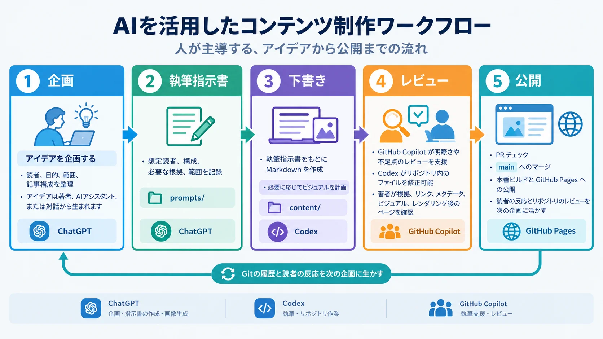

技術記事の制作は、文章を書くだけではありません。読者のニーズを理解し、根拠を集めて確かめ、説明方法を選び、図版を用意し、継続的に管理できるサイトへ統合する必要があります。AIツールは、それぞれの役割を明確にし、成果物を次の工程へ引き継ぐことで、各段階を支援できます。

このサイトでは、リポジトリを中心とするワークフローで ChatGPT、Codex、GitHub Copilot を組み合わせて使います。ChatGPT は編集方針の整理を助け、画像も生成できます。Codex は執筆指示書をもとに、記事の下書きや図を含むリポジトリの変更を作成します。GitHub Copilot は執筆とレビューを支援します。ツールは制作を補助し、テーマや根拠の確認、最終判断は人が担います。

## 3つのツールと主な役割

以下はこのサイトの制作モデルにおける主な役割であり、各ツールができることを限定するものではありません。役割を明確にすると、次に何をすべきか、何を確認すべきかを判断しやすくなります。

| ツール         | 主な役割                                                                                         | 代表的な成果物                                                    |
| -------------- | ------------------------------------------------------------------------------------------------ | ----------------------------------------------------------------- |
| ChatGPT        | アイデアの検討、範囲と構成の整理、企画書や執筆指示書の作成、変更の振り返り、必要に応じた画像生成 | 記事企画書、執筆指示書、画像、改善案                              |
| Codex          | リポジトリのファイルを扱い、執筆指示書をコンテンツや関連アセットに反映                           | Markdown の下書き、Mermaid ソース、統合済みの図、リポジトリの変更 |
| GitHub Copilot | 明瞭さの改善や不足点の発見を通じた執筆とレビューの支援                                           | 表現の改善案、確認事項、修正案                                    |

このサイトでは ChatGPT の企画支援を、制作開始時だけでなくコンテンツのサイクル全体で活用します。アイデアは人から生まれることも、AIアシスタントから提案されることも、対話の中で見つかることもあります。記事を更新した後やリポジトリに新しいコンテンツが加わった後には、Git の履歴や最近の差分を手がかりに、記事の切り口を見直せます。振り返りによって、論旨の分かりにくさや説明のつながりの不足に気づき、次の記事企画書や執筆指示書をより明確にできることがあります。

Codex は、リポジトリを扱う執筆ツールです。記事の作成、関係性を正確に示すための Mermaid 図の下書き、画像生成指示書の準備、選定したアセットの統合を行い、パスやメタデータがサイトの規約に沿っているか確認します。GitHub Copilot は、表現や技術的な説明について別の視点を提供します。そのフィードバックはレビューのきっかけとして扱い、事実の根拠とはみなしません。

## ワークフローの全体像

記事制作では、複数の判断と成果物が連続していきます。アイデアを記事企画書にまとめ、執筆指示書で具体的な要件に落とし込みます。その指示書を記事の下書きに反映し、内容をどう説明するかを考えて視覚表現を計画します。公開前には、ページとアセットを合わせてレビューします。

記事企画書は目的、読者、テーマ、構成を整理し、執筆指示書は書き手が実行できる具体的な指示や制約を示します。こうして判断内容を以前の会話の文脈に頼らず、再利用したり更新したりできる形で引き継ぎます。視覚表現の計画も記事制作の一部です。説明に合う形式を選び、アセットを作成または準備して、ページに統合します。変更をリポジトリの公開プロセスに進める前に、文章とビジュアルを合わせて確認します。

## 記事企画書と執筆指示書に基づく執筆

最初のテーマは、そのままでは広すぎて記事にしにくいことがあります。企画では、誰に向けた記事なのか、読者に何を理解または判断してほしいのか、どこまでを扱うのかを具体化します。このサイトでは ChatGPT を使ってこうした点を検討し、切り口を比べ、記事企画書を整えたうえで、Codex が実行できる執筆指示書を作成します。出発点は、完成したテーマでなくてもかまいません。疑問や日々の仕事で気づいたこと、より明確に説明したい内容から始められます。

記事企画書には、記事の目的、読者、テーマ、狙い、構成を整理します。執筆指示書には、想定読者、記事を読んだ後に得られること、中心となるメッセージ、各セクションの概要、必要な例や根拠、明示的な対象外事項を記録します。これらの情報があると、適切な説明の深さを選びやすくなります。たとえば、概念の解説と実装ガイドを区別したり、読者が読み終えた後に説明できるようになってほしいことを示したり、隣接するテーマのうち別の記事で扱うものを指定したりできます。執筆指示書によって Codex の作業範囲が定まり、不要な推測を減らせます。ただし、指示書だけが要件のすべてではありません。Codex はリポジトリの指示や周辺コンテンツの規約にも従う必要があります。

Codex は執筆指示書を使い、サイトのドキュメントやブログの構成に沿って `content/` の適切な場所に Markdown の下書きを作成します。主張を慎重に述べ、要点に役立つ例を使い、リポジトリの既存規約を保ちます。このリポジトリでは、記事企画書や執筆指示書などの制作指示を `prompts/` に、読者向けの記事やドキュメントを `content/` に分けています。これにより、公開ページと混同せずに編集指示を改善できます。

下書きは執筆指示書に基づく成果物であり、指示書に取って代わるものではありません。記事が意図した問いに答えているか、各セクションが中心的なメッセージにつながっているか、必要な根拠や例がそろっているかを確認します。調査が必要な場合、執筆指示書に根拠を調べる項目を記しておき、AIが生成した説明を鵜呑みにせず、信頼できる情報源で重要な主張を確かめます。下書きによって構成の問題が見つかった場合は、記事企画書や執筆指示書と下書きを一緒に修正します。その後もAIの提案を参考にしながら人がレビューと修正を重ね、記事原稿として仕上げます。

## 画像生成とダイアグラム

ビジュアルは、伝えたい内容に合わせて計画します。抽象的な概念をイメージしやすくしたり、文章では説明しにくい関係性を示したりできます。一方、すべての記事に必要なものではなく、明確な目的なしに画像を加えると読者の注意をそらすことがあります。作成前に、図があることで読者が何をより速く、または正確に理解できるかを考えます。答えが明確でなければ、文章だけで十分かもしれません。

画像生成指示書には、次の4つの要素を含めます。

1. **コンセプト：** 画像で何を伝えるのか、記事でどのような役割を果たすのか。
2. **レイアウト：** どの要素を配置し、それらをどのような位置関係で示すのか。
3. **視覚的な手がかり：** 読者の解釈に必要なラベル、記号、強調など。
4. **スタイル：** 見た目の方向性やトーン、出力サイズまたはアスペクト比、避ける要素。

画像生成指示書は、それだけで必要な情報がそろったものにします。記事や別の図を参照したり、ラベルや関係性をモデルが推測したりしなくても、意図した構図を作れるだけの詳細な情報が必要です。重要な要素とその関係、正確に表示するテキスト、含めない要素を指定します。出力サイズやアスペクト比は、利用場所に合う画像を作る助けになります。画像生成には ChatGPT を使えます。また、状況に応じて Codex のリポジトリ作業に画像生成を含めることもできます。どちらの場合も、採用前に内容との関連性、読みやすさ、意図しない要素がないかを確認します。画像に文字が含まれる場合は、生成文が正確だと決めつけず、ラベルを一つずつ確認します。

構造を明確に示す必要があるワークフロー、手順、アーキテクチャ、判断経路には、構造化されたダイアグラムが適しています。このサイトでは、その具体例として [Mermaid](https://mermaid.js.org/) を使い、ノードや接続、方向をテキストで定義します。先に図の要素とつながりを決めておくと、すべての経路が意図したものか、判断に適切な選択肢があるか、終点が実際のプロセスを表しているかをソース上で確認できます。ロジックと描画結果の両方を検証し、静的な図が必要なら画像として出力します。関係性だけでなく、ラベルや配置も確認します。接続や分岐の正確さが説明の要点である場合、画像生成は信頼できる代替手段ではありません。

この2つの方法は異なる説明に役立ちますが、必ず組み合わせる必要はありません。概念を伝えたり分かりやすくしたりするには概念的な画像が役立ちます。読者に名前の付いた手順や関係性をたどってもらうには、構造化された図が役立ちます。どちらを使うかは、利用可能なツールではなく、伝える情報に基づいて決めます。

## レビュー、リポジトリへの統合、公開

文章とビジュアルの内容を確認したら、ページをサイトに組み込み、公開に向けた準備を進めます。この段階では、記事本文や画像だけでなく、メタデータやサイト内での配置、ナビゲーションも含めて確認します。ドキュメントページの場合、メタデータが適切なタイトルとサイドバーの順序を示しているか、`prev` と `next` がセクション内のナビゲーションとして正しく配置されているかを確認します。関連トピックへのリンクや、翻訳ページから対応する言語版へのリンクも確認します。こうした情報があることで、読者はページを見つけ、意図された順序でドキュメントを読み進められます。

生成または作成した図は、内容を確認して利用可能な状態に整えたうえで、ページへ統合します。アセットはリポジトリ内の相対パスで管理し、ファイル一覧を見たときに用途が分かる名前を付けます。このリポジトリの画像ガイドラインでは、表示用画像をコミット前に WebP へ変換します。それぞれの画像を、意味のある代替テキストと、コンテンツモデルが対応している場合は簡潔で内容を表すタイトルとともに埋め込みます。ラベル、タイトル、代替テキスト、前後の文章の内容を一致させます。代替テキストには画像の存在だけではなく、目的や重要な情報を記します。日本語の翻訳ページではタイトルと代替テキストも日本語にします。こうした統合作業によって、生成した画像がページとともに保守されるアセットになります。

GitHub Copilot は、表現を明確にする案を出したり、不足や矛盾を見つけたり、検証が必要な主張や例を指摘したりできます。このサイトでは、フィードバックを確認して対応する内容を判断し、Codex でリポジトリ内の Markdown や関連ファイルを修正します。有用なレビューでは、事実の正確さと根拠、論理の流れ、確立された慣行と選択可能な方法の区別、文章とビジュアルの整合性、重複、Markdown、リンク、メタデータ、アセットのパスを確認します。図については、周囲の文章が読み方を案内しているか、図だけでは伝わらない情報を補っているかも確認します。実質的な疑問を解決し、変更を採用するか判断するのは人です。AIによるレビューは正確さを保証するものではありません。

記事とアセットを Git で管理すると、差分を確認し、サイトの他の部分との関係を把握できます。プルリクエストを更新するたびにフォーマットチェックが実行され、新しいコミットがレビューの一環として確認されます。Hugo のワークフローはプルリクエストに対してサイトをビルドします。`main` にマージされると、本番サイトをビルドして GitHub Pages にデプロイします。見出し、リンク、レイアウト、ビジュアルがページ内でどう表示されるかを確認します。ビルドが成功しただけでは、図が読みやすいか、ページの内容が意図どおり伝わるかまでは分からないためです。

## ワークフローを効果的にするもの

このプロセスで重要なのは、ツールを3つ使うことより、成果物の引き継ぎを明確にすることです。記事企画書は記事の目的や構成を定め、執筆指示書は実行に必要な要件を示します。下書きがあると、関係者が論旨を具体的に確認できます。自己完結した画像生成指示書は画像に必要な内容を指定し、Mermaid のソースは重要な関係性を確認可能にします。リポジトリ内の相対パスと Git の履歴によって、制作物をサイトに結び付け、後からたどれるようになります。各成果物は作業を止めて確認する機会にもなります。執筆前に範囲を見直し、統合前に誤解を招く画像を差し替え、公開前に分かりにくいセクションを修正できます。

AIの出力は、読みやすい文章でも内容が不正確な場合があり、生成画像が概念を誤って表現したり、図が誤った関係性を示したりすることもあります。そのまま採用せず、意図したメッセージと照らし合わせ、技術的な主張は適切な根拠で検証します。

## 人が主導する、繰り返し可能なプロセス

AIを活用したコンテンツ制作は、反復的なサイクルとして進めるとうまく機能します。企画書で記事の方向性を定め、執筆指示書で要件を具体化し、執筆で下書きにし、必要に応じてビジュアルで説明を補い、レビューでページ全体を改善します。その後、公開ページや読者の反応を次の記事企画書や、より明確な執筆指示書に生かせます。後の作業で新しい文脈が加わったり、レビューで不足が分かったりすれば、以前の記事に戻って見直すこともあります。ツールは作業を支援し、何を公開できる状態とするかは人が判断します。
