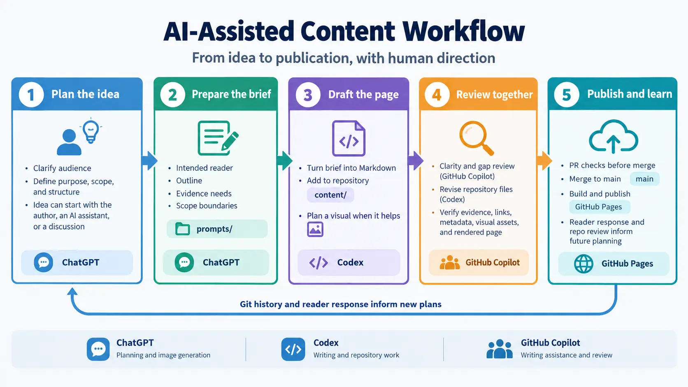
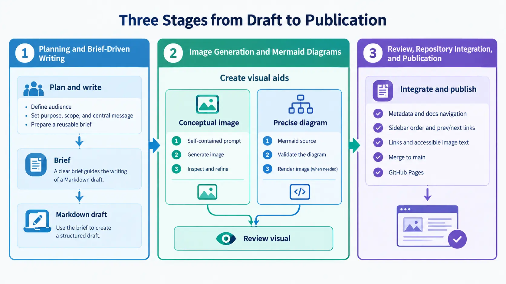

Producing a technical article involves more than drafting paragraphs. The process includes understanding what readers need, gathering and checking evidence, choosing how to explain ideas, preparing figures, and integrating everything into a site that can be maintained over time. AI tools can support each stage most effectively when they have clear roles and the work moves through explicit deliverables.

I use ChatGPT, Codex, and GitHub Copilot as complementary tools in a repository-based workflow. ChatGPT helps me shape the editorial plan and can generate images. Codex turns briefs into repository changes, including article drafts and diagrams. GitHub Copilot supports writing and review. The tools assist the process; I remain responsible for the subject, evidence, and final decisions.

## The Three Tools and Their Primary Responsibilities

These are primary roles in my working model, not exclusive capabilities. Each tool can do more, but a clear division helps me decide what should happen next and what I need to review.

| Tool           | Primary role                                                                                                        | Typical deliverable                                                       |
| -------------- | ------------------------------------------------------------------------------------------------------------------- | ------------------------------------------------------------------------- |
| ChatGPT        | Explore ideas, shape scope and structure, prepare briefs, review changes over time, and generate images when useful | Editorial plan, writing brief, image asset, or improvement suggestions    |
| Codex          | Work with repository files and turn the brief into content and supporting assets                                    | Markdown draft, Mermaid source, integrated figure, and repository changes |
| GitHub Copilot | Support writing and review by improving clarity and identifying gaps                                                | Focused wording suggestions, questions, and proposed revisions            |

I use ChatGPT's planning role throughout the content cycle rather than only at kickoff. An idea may come from me, an AI assistant, or a discussion with one. After an article has changed or the repository has gained new content, I can revisit its framing with the help of Git history and recent diffs. That later review may reveal an unclear argument, a missing connection, or an opportunity to make the next brief more precise.

Codex is my repository-oriented writing tool. I use it to create the article, draft a Mermaid diagram when relationships need to be precise, prepare image-generation prompts, integrate selected assets, and check paths and metadata against the site's conventions. GitHub Copilot offers another perspective on wording and technical explanations. I treat its feedback as a prompt for review, not as evidence that a claim is true.

## The End-to-End Workflow

An article moves through a sequence of connected decisions and deliverables. The idea becomes a brief, the brief guides the draft, and visual planning helps determine how to explain the subject. The resulting page and its assets are reviewed together before publication.

The brief is the handoff between editorial planning and implementation. It captures decisions in a form I can reuse and revise, instead of relying on the context of an earlier conversation. Visual planning is part of developing the article: I choose a form that fits the explanation, create or prepare the asset, and integrate it with the page. Review then considers the prose and visuals together before the changes move through the repository's publication process.

## Planning and Brief-Driven Writing

An initial topic is often too broad to write well. Planning turns it into a specific reader need: who the article is for, what the reader should understand or decide afterward, and which parts of the subject are in scope. I use ChatGPT to explore those choices, compare possible angles, propose a structure, and prepare a brief that Codex can execute. The starting point does not need to be fully formed. It may be a question, an observation from current work, or a subject I want to explain more clearly.

A useful brief records the target reader, desired outcome, central message, section outline, examples or supporting evidence needed, and explicit exclusions. These details help the writer choose the right level of explanation. For example, a brief can distinguish a conceptual overview from an implementation guide, identify what the reader should be able to explain after reading, and state which adjacent topics belong in a separate article. It gives Codex a bounded task and reduces unnecessary improvisation. It is not the only source of requirements: Codex must also follow repository instructions and nearby content conventions.

Codex uses the brief to produce a Markdown draft in the appropriate part of `content/`, following the site's documentation or blog structure. The draft should make its claims carefully, use examples that serve the point, and retain the repository's established conventions. The repository separates writing briefs under `prompts/` from reader-facing documentation and articles under `content/`. That separation lets me improve the editorial instructions without confusing them with the published page.

The draft is an implementation of the brief, not a replacement for it. I check whether the article answers the intended question, whether each section advances the central message, and whether necessary evidence or examples are present. If research is needed, the brief can identify what requires evidence; I then verify substantive claims against reliable sources rather than treating an AI-generated explanation as authoritative. When the draft exposes a flaw in the outline, I can revise the brief and draft together before review.

## Image Generation and Mermaid Diagrams

Visuals should be planned around a communication need. A figure can make an abstract concept easier to picture or reveal relationships that are cumbersome to describe in prose. It is not an automatic requirement for every post, and adding an image without a clear purpose can distract from the article. Before making one, I ask what a reader will understand faster or more accurately with the figure than without it. If the answer is unclear, the prose may be enough.

For an image-generation brief, I use four parts:

1. **Concept:** What idea should the image communicate, and what role does it play in the article?
2. **Layout:** Which elements appear, where they sit, and how they relate to one another.
3. **Visual cues:** Required labels, symbols, emphasis, and other details readers need to interpret the image.
4. **Style:** The visual treatment, tone, output dimensions or aspect ratio, and any prohibited elements.

The prompt should stand on its own. It needs enough detail for a model to create the intended composition without relying on an article, a separate diagram, or assumptions about labels and relationships. It should identify which elements matter most, how they relate, which text must appear exactly, and what must be left out. Output dimensions or aspect ratio help the image fit its intended use. ChatGPT may generate the image; Codex may also include image generation in its repository work when appropriate. In either case, I review the result for relevance, legibility, and unintended content before using it. If the image contains text, I check every label rather than assuming generated wording is accurate.

[Mermaid](https://mermaid.js.org/) is better suited to visuals whose structure must be explicit: workflows, sequences, architectures, or decision paths. I define the nodes, connections, and direction first, then write the Mermaid source. This makes the diagram's logic inspectable as text: I can ask whether every path is intentional, whether a decision has the right alternatives, and whether the endpoints represent the real process. I validate both the logic and rendering, and render it to an image if a static figure is needed. I review the labels and layout as well as the underlying relationships. Image generation is not a reliable substitute when exact connections and branches carry the explanation.

The two paths can support different kinds of explanation, but they do not have to be combined. A conceptual image is useful when the goal is to evoke or clarify an idea; a structured diagram is useful when readers need to follow named steps or relationships. The choice follows the information, not the availability of a particular tool.

## Review, Repository Integration, and Publication

Integration covers the complete page and its place in the site. For a documentation page, I check that its metadata gives it the right title and sidebar order, and that its `prev` and `next` links place it correctly in the section's navigation. I also check that the page links to related topics and that localized pages point to the corresponding language versions. These details help readers find the page and move through the documentation in the intended order.

A selected figure becomes part of the page only after it is usable and integrated. I keep assets in an appropriate repository-relative location and give them descriptive filenames so their purpose is recognizable in the file tree. The repository's image guidance calls for converting display images to WebP before committing them. I embed each image with meaningful alternative text and, where the content model supports it, a concise descriptive title. The labels, title, alternative text, and surrounding prose should agree: alternative text should convey the figure's purpose or key information, not merely say that an image is present. Japanese localized pages should localize titles and alternative text as well. This integration work makes the figure part of the maintained page rather than an unattached generated file.

GitHub Copilot can suggest clearer wording, identify gaps or contradictions, and flag claims or examples that may need verification. I use that feedback to decide what deserves attention; Codex can then revise the Markdown and related files in the repository. A useful review checks factual accuracy and evidence, logical flow, the distinction between established practice and optional approaches, consistency between prose and visuals, repetition, and Markdown, links, metadata, and asset paths. For a figure, I also check that the surrounding text prepares the reader to interpret it and explains details the visual cannot carry on its own. Human judgment is still needed to resolve substantive questions and accept or reject changes; AI review is not a guarantee of correctness.

I keep the article and its assets in Git, where I can inspect the changes as a diff and see how they relate to the rest of the site. Each update to a pull request runs the formatting check, so new commits are checked as part of review. The Hugo workflow also builds the site for pull requests; after a merge to `main`, it builds the production site and deploys it to GitHub Pages. I inspect the rendered page to check its headings, links, layout, and visual assets in context, since a successful build alone does not tell me whether a figure is easy to read or whether the page communicates as intended.

## What Makes the Workflow Effective

The process depends less on having three tools than on making the handoffs clear. The brief says what the article must accomplish. The draft gives me and other reviewers a concrete argument to inspect. A self-contained visual prompt specifies what an image must show, while Mermaid source makes important relationships inspectable. Repository-relative files and Git history keep the work connected to the site and make later revisions traceable. Each deliverable also creates a useful point to pause: I can revise the scope before drafting, reject a misleading image before integration, and fix a confusing section before publication.

These practices also help keep tool output in perspective. A polished paragraph can still be inaccurate; a generated image can still misrepresent an idea; a diagram can still encode the wrong relationship. Review the artifact against the intended message, and verify technical claims with suitable evidence.

## A Repeatable, Human-Directed Process

AI-assisted content creation works best as an iterative cycle. Planning shapes the brief, writing turns it into a draft, visual work supports the explanation where useful, and review improves the complete page. The rendered site and reader response can then inform future articles and sharper briefs. I may return to an earlier article when later work adds context or when a review reveals a gap. The tools help carry the work forward, while I direct the process and decide what is ready to publish.
