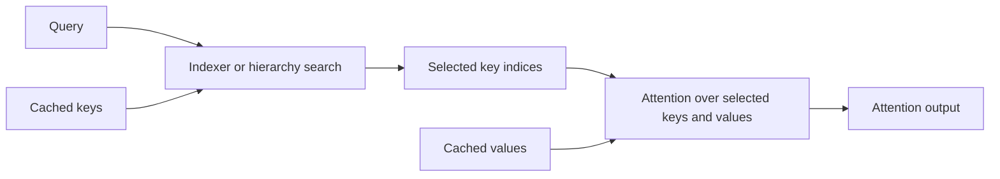

Sparse attention reduces the number of token pairs that participate in attention. Instead of letting every query attend to every key, a sparse pattern or selection mechanism restricts the set of keys that each query can use. The goal is to make long-context attention more efficient while preserving the information paths a model needs.

Sparse attention is not one algorithm. It is a family of designs that make different choices about which interactions to retain, how to select them, and how to execute the resulting pattern efficiently.

## Why Attention Becomes Expensive

In self-attention, each token produces a query, key, and value vector. The attention score between a query and a key determines how much of the corresponding value contributes to the output.

For a sequence of length \(N\) and head dimension \(d\), the score and value operations in standard dense attention require work proportional to \(O(N^2d)\). The attention matrix has \(N^2\) entries, so its size grows quadratically with sequence length.

This cost is especially significant during long-context prefill, when a model processes many prompt tokens at once. During autoregressive decoding, each new token may need to access the keys and values of all preceding tokens. A KV cache avoids recomputing those past projections, but reading and attending to a long cache can still be expensive.

Sparse attention addresses the attention interaction pattern itself: it limits which keys a query can read or score.

## Dense and Sparse Attention

Dense attention computes a query-to-key score for every allowed pair of positions. In causal self-attention, future positions are masked, but each query can still attend to all preceding positions.

Sparse attention replaces this full pattern with a smaller set of interactions. Depending on the design, the pattern may be fixed, structured, learned, or selected dynamically from the input.

A useful distinction is:

- **Dense attention:** every permitted query-key pair is computed.
- **Sparse attention:** only a subset of permitted query-key pairs is computed.
- **Efficient dense attention:** the same dense attention result is computed with better memory movement or kernel organization.

The last category includes FlashAttention. It improves the implementation of exact dense attention; it does not, by itself, make the attention matrix sparse.

## Common Sparse Patterns

The following patterns describe design dimensions, not mutually exclusive algorithm classes. A practical method may combine several of them.

### Local or Sliding-Window Attention

Each query attends to a neighborhood around its position, often a fixed number of preceding tokens in a causal model. This gives a predictable sparse pattern and can reduce the attention work to roughly \(O(Nwd)\), where \(w\) is the window size.

Local attention is effective when nearby context carries much of the useful signal. However, information from far away must travel through multiple layers or another global pathway. A fixed window does not provide direct access to every distant token.

### Global or Selected Tokens

Some designs designate a small number of tokens as global, allowing them to exchange information with many or all positions. Others preserve selected important positions or add summary tokens.

Global pathways can help connect distant parts of a sequence without restoring a fully dense matrix. Their cost depends on how many global positions are used and how the pattern is implemented.

### Block-Sparse Attention

Instead of selecting individual token pairs, block-sparse methods operate on blocks of queries and keys. Blocks can be arranged in local bands, selected regions, or other structured patterns.

Block sparsity can align better with GPU memory access and matrix operations than irregular token-level sparsity. The trade-off is granularity: a selected block may include some unnecessary interactions, while a very fine pattern can be harder to execute efficiently.

### Dynamic or Content-Based Selection

Dynamic methods use the input or a learned scoring mechanism to select keys for each query. A query may retrieve the top-scoring tokens, blocks, or summaries rather than follow a fixed window.

This can preserve relevant distant information, but selection has a cost. If the indexer scores every query against every key, its own work may remain quadratic even when the final attention reads only a small subset. End-to-end efficiency depends on both the selector and the attention kernel.

## A Pattern View

The matrix below is schematic. Rows represent queries and columns represent keys; filled cells indicate interactions that are computed.

```text
Dense          Local window     Global + local    Block sparse
████████       ··███···         ████████          ████····
████████       ··█████·         ████████          ████····
████████       ···█████         ··██████          ····████
████████       ····███·         ··██████          ····████
████████       ·····███         ····████          ████····
████████       ······██         ····████          ████····
```

The pattern alone does not determine quality or speed. The model must learn to use the retained pathways, and the implementation must map them efficiently to the target hardware.

## Representative Approaches

### Longformer

Longformer combines local sliding-window attention with task-specific global attention. It is an influential example of using a structured sparse pattern for long documents rather than a fully dense attention matrix.

### BigBird

BigBird combines local, global, and random attention connections. The mixture is intended to retain local structure while enabling information to move across distant positions. Its pattern illustrates that sparse designs can combine multiple connection types.

### Mistral and Sliding-Window Models

Mistral 7B is a well-known decoder-only model that uses sliding-window attention. Sliding windows limit the context directly attended to by a layer; the effective receptive field can grow across stacked layers. Exact behavior depends on the model configuration and inference implementation.

### Native Sparse Attention (NSA)

Native Sparse Attention uses a hierarchical strategy that combines compressed context, selected fine-grained tokens, and local attention. Its design emphasizes both learnability and hardware-aligned execution. NSA is a particular method, not a synonym for all sparse attention.

### DeepSeek Sparse Attention (DSA)

DeepSeek Sparse Attention uses a learned Lightning Indexer to select a subset of KV entries for attention. In DeepSeek-V3.2, DSA is used alongside Multi-head Latent Attention (MLA). The indexer and selected attention are distinct components; selection overhead and memory-access behavior remain important to practical performance.

## Latent Sparse Attention

The name **Latent Sparse Attention** is used in the paper [Latent Sparse Attention: Towards Subquadratic Ultra-Long Context Attention](https://arxiv.org/abs/2610.42147) (October 2026). In this method, keys are hierarchically clustered in a learned latent space. Queries score the cluster hierarchy and use it to narrow the keys considered for attention, rather than scoring every key individually. The acronym **LSA is ambiguous** in recent literature: [LongCat Sparse Attention](https://arxiv.org/abs/2608.01662) also uses LSA for a different method based on streaming-aware, cross-layer, and hierarchical indexing. Use the full paper name when referring to either approach.

The paper describes two training variants: Distilled-LSA, which adapts a pretrained model through distillation, and Native-LSA, which is trained with the next-token objective. The authors report experiments at ultra-long context lengths, including up to 10 million tokens. These are paper-reported results, not a guarantee for arbitrary models, hardware, or workloads; the work is a recent preprint and should be treated as emerging research.

Do not confuse this method with **Multi-head Latent Attention (MLA)**. MLA compresses key and value representations into a latent vector to reduce KV-cache storage, then reconstructs or projects the needed per-head representations. MLA is primarily a KV-cache compression architecture; it does not inherently mean that only a sparse subset of token positions is attended to.

“Latent” therefore describes different ideas in these names: LSA uses a learned latent space to organize and search keys, while MLA uses a compressed latent representation for keys and values. Neither term should be used as a generic label for every sparse or latent attention mechanism.

## Efficiency and Trade-offs

Sparse attention can reduce arithmetic and the amount of KV data read by the attention operation, but realized speedups depend on more than the number of nonzero entries.

- **Selection overhead:** A dynamic indexer can become a bottleneck if it performs extensive scoring before attention.
- **Memory access:** Irregular key selection can cause scattered reads and reduce GPU utilization. Block or hierarchical designs may improve locality.
- **Kernel support:** Sparse patterns need efficient kernels. A theoretically smaller operation can be slower than a highly optimized dense kernel at moderate sequence lengths.
- **Quality and reach:** Removing interactions can lose useful long-range dependencies. Global tokens, summaries, hierarchical retrieval, or stacked layers can help, but each adds design choices.
- **Workload:** Prefill, single-token decoding, batch size, cache layout, and context length can change which method is fastest.

Sparse attention is therefore best evaluated end to end: include index construction, selection, cache reads, attention kernels, and the model's quality on the intended context distribution.

## Related Efficiency Techniques

Sparse attention is one part of a broader set of attention and inference optimizations.

| Technique | What it changes |
| --- | --- |
| Sparse attention | Which query-key interactions are computed |
| Linear attention | The formulation of attention to avoid explicit all-pairs computation under particular assumptions |
| FlashAttention | The exact dense attention computation's memory traffic and kernel organization |
| GQA / MQA | How query heads share key and value heads, reducing KV-cache size and bandwidth |
| KV-cache optimization | How past keys and values are stored, quantized, paged, or reused |

These techniques can be combined. For example, a model may use grouped-query attention, a KV cache, and a sparse attention selector. The combination should be described by the actual model architecture rather than inferred from any one label.

## Query-to-Key Selection Flow

A content-based sparse attention layer typically separates candidate selection from the final attention calculation:



The indexer may score individual keys, blocks, or latent clusters. The selected indices determine which key-value entries the attention kernel reads. This diagram is a conceptual flow; concrete implementations differ in their scoring, cache layout, and kernel fusion.

## Foundational and Further Reading

- [Attention Is All You Need](https://arxiv.org/abs/1706.03762) — the original Transformer architecture.
- [Longformer: The Long-Document Transformer](https://arxiv.org/abs/2004.05150) — local window and global attention.
- [Big Bird: Transformers for Longer Sequences](https://arxiv.org/abs/2007.14062) — local, global, and random sparse connections.
- [FlashAttention](https://arxiv.org/abs/2205.14135) — exact attention with IO-aware computation.
- [Native Sparse Attention](https://arxiv.org/abs/2502.11089) — trainable, hardware-aligned hierarchical sparse attention.
- [DeepSeek-V3.2 Technical Report](https://arxiv.org/abs/2512.02556) — DeepSeek Sparse Attention.
- [DeepSeek-V2](https://arxiv.org/abs/2405.04434) — Multi-head Latent Attention and KV-cache compression.
- [Latent Sparse Attention](https://arxiv.org/abs/2610.42147) — learned latent hierarchy for ultra-long-context key selection.

## Summary

Sparse attention reduces the set of token interactions computed by an attention layer. Local, global, block, and dynamic patterns make different trade-offs between access to distant information, selection cost, and hardware efficiency. The most useful design is not simply the sparsest one: it is the one that preserves task-relevant information and delivers a measurable end-to-end benefit on the intended workload.

For the basic Transformer mechanics, see [Transformers](/docs/ai/deep-learning/transformers/).