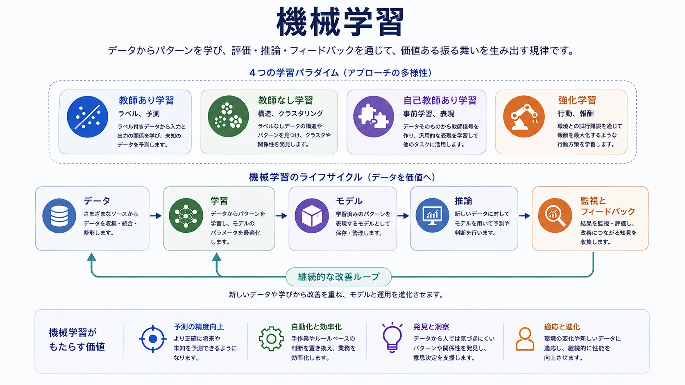

機械学習が AI の中心になったのは、有用なタスクの多くが固定的なルールだけでは扱えないほど変化に富むからです。不正のパターン、顧客行動、画像の分類、言語の使われ方は変化し続けます。あらゆる条件を手作業で記述する代わりに、機械学習は例とフィードバックから有用なパターンを推定させます。

ただし、エンジニアリング上の判断が不要になるわけではありません。課題はデータ品質、目的設計、評価、汎化、運用上のドリフトを扱うことへ移ります。機械学習はモデリング技法であるだけでなく、振る舞いを構築・維持する別の方法です。

## 定義

機械学習は、データからパターンを学ぶことでタスク性能を改善するシステムを構築する分野です。すべての判断ルールを明示する代わりに、エンジニアは目的を定め、例を準備し、表現を選び、得られたモデルが学習データ以外にも汎化するかを評価します。

これは学習された振る舞いを扱う AI の一部であり、純粋なルールベースの手法とは異なります。ただし、実際のシステムでは両者を組み合わせることが少なくありません。

## 機械学習が重要な理由

手作業のロジックをスケールさせるには変動が大きすぎるとき、機械学習は重要です。検索結果の順位付け、スパム検知、需要予測、文書分類、製品推薦、音声認識では、ルールとして列挙するよりもデータから学ぶ方が扱いやすいパターンが現れます。

その代償として、学習システムは確率的です。完全な振る舞いを保証するものではなく、コードの検査だけではなく、証拠、誤り分析、運用監視によって判断する必要があります。

## 機械学習システムのライフサイクル

機械学習システムは、データ収集と問題設定から始まります。どのシグナルが重要か、成功をどう定義するか、例をどう収集・ラベル付けするかを決めます。この段階は、アルゴリズム選択以上に結果を左右することがあります。

学習では、データを有用なパターンを捉えるモデルへ変換します。検証とテストでは、モデルが汎化するか、重要な部分集団で系統的に失敗しないか、意図した用途に十分な性能があるかを確認します。

推論は、モデルを実際のワークフローで使う段階です。レイテンシ、鮮度、フィードバックループ、オフライン評価と本番の振る舞いの差が新たな関心事になります。そのため監視は後付けではなく、ライフサイクルの一部です。

## よく使う評価概念

**汎化**は、学習データを記憶するだけでなく、新しいデータでも良い性能を示す能力です。

**バイアスと分散**は異なる失敗モードを表します。モデルが単純すぎて有用な構造を捉えられない場合もあれば、学習データに敏感すぎて本番で安定しない場合もあります。

**過学習と過少適合**はその実務的な現れです。過学習は学習データを具体的に覚えすぎること、過少適合は十分に有用な構造を学べないことです。

**オフライン評価とオンライン評価**は異なる目的に役立ちます。オフラインのテストは統制された比較を可能にし、オンラインの振る舞いは実際の利用者との相互作用、変化する入力、フィードバックループの下での性能を示します。

## トピックページ









## 関連するトピックとの関係

ディープラーニングは、機械学習の中でも多層ニューラルネットワークを使い、より豊かな表現を大規模に学ぶ専門領域です。基盤モデルは、大規模な事前学習と再利用を通じて、こうしたディープラーニングの手法を発展させます。

MLOps は、バージョン管理、デプロイ、監視、再学習、ドリフト管理を担い、機械学習を運用可能にします。この運用基盤がなければ、優れたモデルであっても世界の変化とともに性能が低下します。

## まとめ

機械学習は、網羅的に人が記述したルールではなく、データから有用な振る舞いを構築する AI の領域です。適応性に価値がありますが、その適応性はデータ品質、評価の規律、運用への依存も生みます。主要な学習パラダイムとライフサイクルを理解すると、現代の AI を考えやすくなります。
