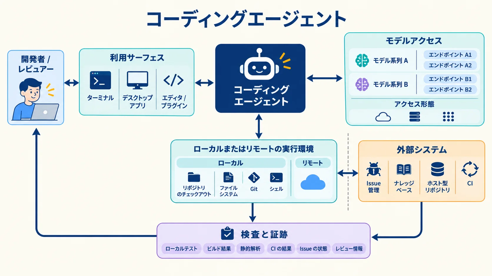
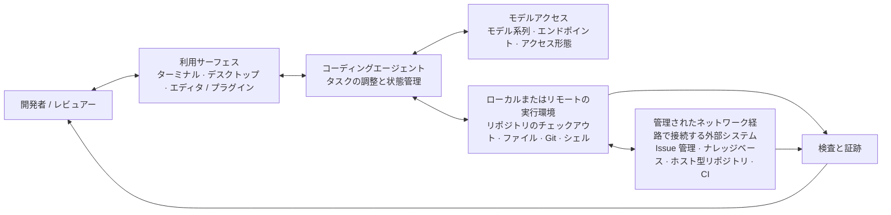

コーディングエージェントは、モデル、利用サーフェス、リポジトリ用ツール、外部システム、実行環境を組み合わせてソフトウェア開発タスクを調整します。情報を集め、範囲を限定して変更し、検査を実行し、レビューに必要な結果を返します。価値の中心はコード生成だけではなく、複数の手順やシステムをまたいで作業を進めることにあります。

モデルとエージェントは異なる役割を持ちます。モデルは文脈を解釈し、行動を提案または選択します。エージェントの実行基盤は、その行動を整理し、ツールを呼び出し、タスクの状態を管理し、結果を報告します。利用できる文脈、ツール、権限、実行環境は周囲のハーネスによって決まります。詳しくは [ハーネスエンジニアリング](/ja/docs/swe/ai-as-software-engineering-tool/harness-engineering/) を参照してください。

## コーディングエージェントのアーキテクチャ

アーキテクチャには、個別に考えるべき複数の側面があります。利用サーフェスは人がエージェントにアクセスする方法です。モデルアクセスは推論能力をどのように得るかを示します。ツールはその役割で分類し、実行場所はツールがどこで動き、何に到達できるかを表します。これらの選択肢は開発ワークフローの中で連携しますが、単一の固定された構成ではありません。

この図は一般的な関係を示すもので、すべての連携が必須という意味ではありません。特定のエージェントが利用するサーフェス、モデル、ツール、システムは構成によって異なり、実行場所もローカルまたはリモートになります。

## 利用サーフェス

利用サーフェスとは、人がエージェントに作業を依頼し、進行状況を確認するためのインターフェースです。ターミナル、専用デスクトップアプリ、エディタやプラグインとの統合などがあります。サーフェスによって、指示の入力方法、文脈や変更の表示方法、影響の大きい操作を人が承認する方法が変わります。

サーフェスと実行環境は同じものではありません。ターミナルが利用者向けの画面でも、エージェントのコマンドはリモートワークスペースで動く場合があります。逆に、エディタ統合からローカルのチェックアウトを直接操作するツールを制御することもできます。人が作業を指示・確認する方法に合わせてサーフェスを選び、実行場所と権限は別に評価します。

## モデル系列、エンドポイント、アクセス形態

モデルへの接続には、次の三つの選択肢があります。

- **モデル系列:** 文脈の解釈やタスクの推論に使うモデルの種類です。
- **エンドポイント:** モデルに接続するためのサービスまたは実行環境です。
- **アクセス形態:** クラウドのマネージドサービス、自社管理のクラウド環境、ローカルでのモデル実行など、エンドポイントの提供・運用方法です。

これらは関連していますが、一対一に対応するものではありません。一つのモデル系列が複数のエンドポイントから利用できる場合があり、一つのエンドポイントが複数のモデル系列を提供する場合もあります。アクセス形態によって、レイテンシ、処理能力、運用負荷、データの取り扱い、コストのトレードオフが変わります。どの形態が常に優れているということはありません。

モデルを実行する場所と、コーディングエージェントのツールを実行する場所も別の選択です。モデルはローカルで動かしながらリポジトリ用ツールはリモートワークスペースで動かすことも、クラウド上のモデルと開発者端末上のツールを組み合わせることもできます。そのため、モデルエンドポイントへのネットワーク経路と、エージェント実行環境のネットワーク権限は分けて検討します。

## 役割別に見るツールと接続先

ツールは一括りにせず、どのような作業を担うかで整理します。エージェントの実行環境内で直接動くツールもあれば、統合を通じて接続する独立したサービスもあります。

| 役割             | 例                                                                                 | 典型的なやり取り                                                                         |
| ---------------- | ---------------------------------------------------------------------------------- | ---------------------------------------------------------------------------------------- |
| 開発リソース     | ローカルのリポジトリチェックアウト、ホスト型リポジトリサービス、Issue 管理システム | ソースコードやタスクの文脈を読む。許可された編集、ブランチ作成、プルリクエスト更新を行う |
| ナレッジリソース | ドキュメント、仕様、アーキテクチャ上の決定、チームのナレッジベース                 | 関連する指針や決定事項を参照する。通常は読み取り中心                                     |
| 実行と検証       | ローカルシェル、ビルドツール、テスト、CI サービス                                  | コマンドや検査を実行し、ログ、状態、証跡を返す                                           |

リポジトリには、ローカルとホスト型の側面があります。チェックアウトされた作業ツリーは実行環境内のデータであり、ファイルシステムや Git のツールが権限の範囲内で読み書きします。ホスト型リポジトリサービスはネットワーク越しに接続する別のシステムで、リモートブランチ、Issue、プルリクエストを提供したり、許可された push や更新を受け取ったりします。この二つを同じものとして扱うと、操作がどこで行われ、どの境界で制御されるかが見えにくくなります。

ツールの利用可否は、サーフェスや統合方法によっても異なります。たとえば、ターミナルという利用サーフェスは人がエージェントを操作する場所です。一方、シェルツールはエージェントがコマンドを実行する機能です。両者は連携していても、役割と権限は異なります。

## 実行場所とネットワーク境界

リポジトリ用ツールは実行環境内で動き、その環境がアクセスできるファイル、プロセス、サービスが決まります。開発者の端末、分離されたローカル worktree、管理されたリモートワークスペース、CI runner などが実行場所の選択肢です。場所によって、分離性、協働のしやすさ、再現性、レイテンシ、ローカル資源へのアクセスが変わります。

実行場所とツールの役割は独立しています。ファイル、Git、シェルのツールは、ローカルまたはリモートのどちらのワークスペースにあるチェックアウトに対しても動作します。ローカル環境だからといって、開発者端末やネットワークへの無制限のアクセスを意味するわけではありません。リモート runner も、自動的に隔離され信頼できるとは限りません。エージェントが実際に触れられる対象を実行環境で定める必要があります。

CI サービスと、その runner も役割が異なります。CI サービスはジョブの依頼を受け、状態やログを返します。ビルドやテストのコマンドを実際に実行するのは runner またはワークスペースです。サービスは外部連携先であり、runner は実行環境です。runner にも、ファイル、プロセス、ネットワークのそれぞれにアクセス境界を設ける必要があります。

ネットワークアクセスは、もう一つの境界です。ローカルのリポジトリ操作にはネットワークが不要な場合がありますが、モデルエンドポイント、Issue 管理、ナレッジベース、ホスト型リポジトリ、CI サービスへの接続にはネットワーク経路を使います。ハーネスは許可する接続先とデータの流れを明確にし、ネットワーク権限をファイルやプロセスの権限とは別に管理します。認証情報は必要な統合や操作に限定し、通常のモデル文脈として見せないようにします。

## 役割、タスク境界、権限

コーディングエージェントは、リポジトリの理解、実装、テスト、レビュー準備、移行、運用調査を支援できます。タスクでは期待する成果、範囲、不変条件、完了を示す証跡を明らかにします。これにより、読み取りを中心とする調査と、変更や実行を区別できます。

権限は操作と境界ごとに定義します。リポジトリを読む権限があっても、変更する権限があるとは限りません。ファイル編集の許可から、任意コマンドの実行、ネットワークアクセス、認証情報の利用、プルリクエストの更新、外部への連絡、本番変更まで許可されたとは限りません。ファイルシステム、プロセス実行、ネットワーク、認証情報にはそれぞれ明示的な範囲を設けます。影響や取り消しやすさに応じて、人のレビューを操作前に置き、レビュアーには対象範囲と判断に必要な証跡を提示します。

指示と取得したコンテンツにも、信頼度の違いがあります。プラットフォームの制約、リポジトリ方針、タスクの指示、ソースファイル、Issue のコメント、ツール出力は競合する場合があります。信頼できるワークフローでは、適用される指示の優先順位を保ち、プロジェクトの正式な方針と、信頼できない、または偶発的に得られたテキストを区別します。重要な制約が無関係な情報に埋もれないよう、タスクに必要な文脈を与えます。

## 協働する開発ワークフロー

典型的なタスクでは、Issue を起点に、ナレッジベースや仕様から背景を得て、リポジトリのチェックアウトを調べ、範囲を限定した変更を行い、ローカル検査や CI で証跡を集めます。その後、変更内容と結果をプルリクエストなどにまとめ、人のレビューへ引き継ぎます。これは一例であり、固定の処理順ではありません。統合先は任意で、エージェントはタスクに必要なシステムだけを使います。

協働のループでは、担当範囲と証跡を明確にします。

1. **タスクを定義する:** 目標、範囲、制約、受け入れ条件を決めます。
2. **文脈を集める:** 許可された経路で、関連する Issue、リポジトリ、ナレッジを参照します。
3. **範囲を限定した環境で作業する:** 割り当てられたチェックアウトを、利用可能なローカルまたはリモートのツールで調査・変更します。
4. **検証する:** 適切な検査を実行し、結果を証跡として記録します。
5. **レビューに引き継ぐ:** 変更点、実施した検査、不確かな点、必要な判断や後続作業を伝えます。

人とエージェントで作業を分担したり、独立した作業を並行して進めたりすることもできます。効果を得るには、各作業の所有者、分離された作業環境または明示的なファイル境界、成果を統合する地点が必要です。現在の状態や次の確認事項が分かるよう、共有状態、計画、差分、検証結果を記録します。

## まとめ

コーディングエージェントは、人とモデルの能力を、リポジトリ用ツールや独立した開発システムにつなぐ調整役です。利用サーフェス、モデルアクセス、ツールの役割、実行場所、ネットワーク経路、権限は、それぞれ別の設計要素です。これらの境界を明示し、実際に動く環境で変更を検証し、人が次の作業を判断・調整できる証跡を返すことで、信頼できるワークフローになります。
