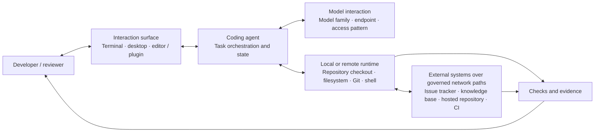

A coding agent coordinates a software-engineering task by combining a model with interaction surfaces, repository tools, external systems, and a runtime environment. It can gather context, make bounded changes, run checks, and return results for review. Its engineering value comes from coordinating this work across steps and systems, not from code generation alone.

The model and the agent have different roles. A model interprets context and proposes or selects actions. The agent runtime organizes those actions, invokes tools, manages task state, and reports results. The surrounding harness determines what context, tools, permissions, and execution environments are available; see [Harness Engineering](/docs/swe/ai-as-software-engineering-tool/harness-engineering/).

## A coding-agent architecture

The architecture has several dimensions that should be considered separately. An interaction surface is how a person reaches the agent. Model access describes how the agent obtains reasoning capability. Tools are classified by the work they do, while execution location describes where they run and what they can reach. These choices meet in an engineering workflow, but they are not one fixed stack.

The diagram shows common relationships, not mandatory integrations. A particular agent may use only some surfaces, models, tools, or systems, and it may run in a local or remote environment. Capabilities and connections depend on the product and its configuration.

## Interaction surfaces

An interaction surface is the interface through which a person gives work to the agent and reviews its progress. Common surfaces include terminal interfaces, dedicated desktop applications, and editor or plugin integrations. A surface affects how instructions are entered, how context and changes are shown, and how people approve consequential actions.

A surface is not the same as the execution environment. A terminal can be the user interface while the agent's commands run in a remote workspace. Conversely, an editor integration can control tools that operate directly on a local checkout. Choose a surface for the way people need to steer and inspect work; evaluate execution location and permissions separately.

## Model families, endpoints, and access patterns

Model interaction has three distinct choices:

- **Model family:** the model capability used to interpret context and reason about the task.
- **Endpoint:** the service or runtime through which the model is reached.
- **Access pattern:** how the endpoint is provided and operated, such as a cloud-managed service, a self-managed cloud deployment, or local model execution.

These dimensions are related but not one-to-one. A model family may be available through multiple endpoints, and one endpoint may provide access to multiple model families. Access patterns introduce different trade-offs in latency, capacity, operations, data handling, and cost; none is universally preferable.

Model execution location is also separate from coding-agent tool execution location. A model may run locally while repository tools run in a remote workspace, or a cloud model may be paired with tools running on a developer workstation. The model endpoint's network path and the agent runtime's network permissions therefore need separate consideration.

## Tools and connected systems by role

Tools should be understood by the work they perform, rather than treated as one undifferentiated list. Some tools operate directly inside the agent's runtime; other systems are independent services reached through an integration.

| Role                     | Examples                                                                   | Typical interaction                                                                                          |
| ------------------------ | -------------------------------------------------------------------------- | ------------------------------------------------------------------------------------------------------------ |
| Development resources    | Local repository checkout, hosted repository service, issue tracker        | Read source and task context; make authorized edits; create branches or update pull requests where permitted |
| Knowledge resources      | Documentation, specifications, architecture decisions, team knowledge base | Retrieve relevant guidance and decisions; usually read-oriented                                              |
| Execution and validation | Local shell, build tools, tests, CI service                                | Run commands and checks; return logs, status, and evidence                                                   |

A repository has both a local and, often, a hosted aspect. The checked-out working tree is data in the execution workspace: filesystem and Git tools can inspect or modify it according to their permissions. A hosted repository service is a separate networked system that may provide remote branches, issues, or pull requests and may receive authorized pushes or updates. Treating these as one object hides where an operation occurs and which boundary controls it.

Tool availability also depends on the surface and integration design. For example, a terminal interaction surface lets a person steer an agent, while a shell tool lets the agent execute a command. They may be connected, but they have different roles and authority.

## Execution location and network boundaries

Repository tools execute in a runtime environment that determines which files, processes, and services they can reach. Common choices include a developer workstation, an isolated local worktree, a managed remote workspace, or a CI runner. These locations affect isolation, collaboration, reproducibility, latency, and access to local resources.

Execution location is independent of tool role. Filesystem, Git, and shell tools may operate on a checkout in either a local or remote workspace. A local workspace does not imply unrestricted access to the developer's machine or network; a remote runner is not automatically isolated or trusted. The environment must define what the agent can actually touch.

A CI service and its runner also have different roles. The CI service receives a job request and returns status and logs; a runner or workspace executes the build and test commands. The service is an external integration, while the runner is an execution environment whose filesystem, process, and network access need their own boundaries.

Network access forms another boundary. Local repository operations may require no network, while model endpoints, issue trackers, knowledge bases, hosted repositories, and CI services are reached over network paths. The harness should make allowed destinations and data flows explicit, and manage network permission separately from filesystem and process permissions. Credentials should be scoped to the integrations and actions that need them, and should not be exposed as ordinary model context.

## Roles, task boundaries, and authority

Coding agents can assist with repository understanding, implementation, testing, review preparation, migration, and operational investigation. A task should state its intended outcome, scope, invariants, and completion evidence. The agent can then separate read-oriented investigation from changes and execution.

Authority should be defined by action and boundary. Permission to read a repository does not imply permission to modify it. Permission to edit files does not automatically permit arbitrary command execution, network access, credential use, pull-request updates, external communication, or production changes. Filesystem access, process execution, network access, and credentials should each have explicit scopes. Human review belongs before actions whose impact or reversibility calls for it, and reviewers should receive the proposed scope and relevant evidence.

Instructions and retrieved content also have different trust levels. Platform constraints, repository policies, task instructions, source files, issue comments, and tool output may conflict. A reliable workflow preserves the applicable instruction hierarchy and distinguishes authoritative project guidance from untrusted or incidental text. Context should be sufficient for the task without burying important constraints in irrelevant material.

## A collaborative engineering workflow

A typical task may start with an issue, use a knowledge base or specification for context, inspect a repository checkout, make a scoped change, run local checks, and use CI or other services to gather further evidence. The agent can then summarize the change and results in a pull request or another handoff for human review. This is one example, not a required sequence: integrations are optional, and the agent should use only the systems needed for the task.

The collaboration loop should make ownership and evidence visible:

1. **Frame the task:** define the goal, scope, constraints, and acceptance evidence.
2. **Gather context:** retrieve relevant issue, repository, and knowledge resources through permitted paths.
3. **Work in a bounded environment:** inspect and change the assigned checkout using available local or remote tools.
4. **Validate:** run appropriate checks and capture their results as evidence.
5. **Review and hand off:** explain what changed, what was checked, what remains uncertain, and what decision or follow-up is needed.

People and agents may divide work or run independent workstreams in parallel. This helps only when each stream has clear ownership, an isolated workspace or explicit file boundaries, and a defined integration point. Shared state, plans, diffs, and validation results should be recorded so collaborators can tell what is current and what still needs review.

## Summary

A coding agent is an orchestrator that connects people and model capability to repository tools and independent engineering systems. The interface, model access, tool roles, execution location, network paths, and permissions are separate design dimensions. A dependable workflow makes those boundaries explicit, validates changes in the environment where they run, and returns evidence that people can review and use to coordinate the next step.
